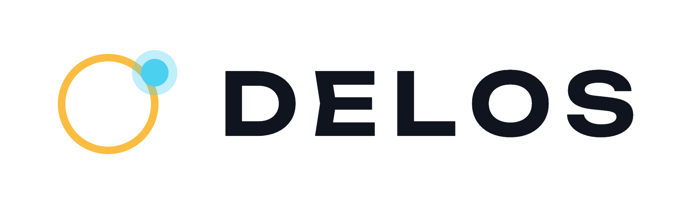
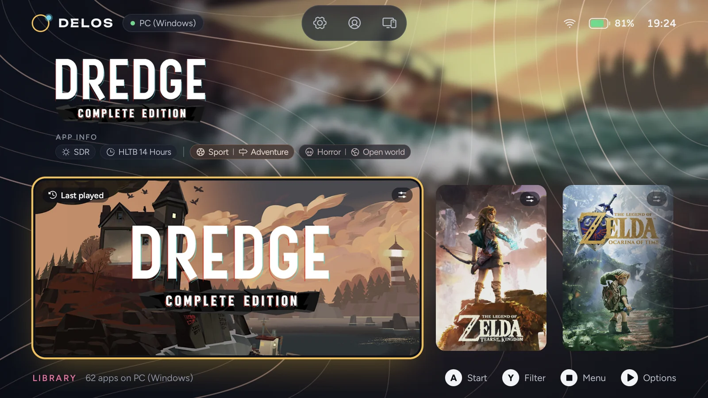

<picture>
  <source media="(prefers-color-scheme: dark)" srcset="docs/readme/logo-dark.png">
  
</picture>

**Game streaming for Android handhelds**, with a console-like interface you can drive entirely with a gamepad.

[Website](https://delos-stream.com) · [Releases](https://github.com/DELOS-STREAM/DELOS-android/releases) · [Issues](https://github.com/DELOS-STREAM/DELOS-android/issues) · [Add to Obtainium](https://apps.obtainium.imranr.dev/redirect?r=obtainium://add/https://github.com/DELOS-STREAM/DELOS-android)

An Android game streaming client built for gaming handhelds. It is built and tested with [Vibepollo](https://github.com/Nonary/Vibepollo). [Apollo](https://github.com/ClassicOldSong/Apollo) and [Sunshine](https://github.com/LizardByte/Sunshine) use the same protocol and are expected to work; they are not tested yet.

> **Early release.** Delos 1.0.0 is the first public release. It is developed and tested by one person on one handheld, so expect rough edges. Reports are welcome.

## ✨ What is Delos?

Delos streams games from your PC to an Android handheld. It is built for the handheld first: a console-like interface native to Android that works with the D-pad, sticks and A/B/X/Y, instead of a phone app stretched onto a bigger screen. It started as a fork of [Artemis](https://github.com/ClassicOldSong/moonlight-android), which is a fork of [Moonlight](https://github.com/moonlight-stream/moonlight-android), and has since gone its own way.

## 🔌 Works with

| | Area&nbsp;&nbsp;&nbsp;&nbsp;&nbsp;&nbsp;&nbsp;&nbsp;&nbsp;&nbsp;&nbsp;&nbsp;&nbsp;&nbsp;&nbsp;&nbsp;&nbsp;&nbsp;&nbsp;&nbsp;&nbsp;&nbsp;&nbsp;&nbsp;&nbsp;&nbsp;&nbsp;&nbsp; | Details |
|---|---|---|
| 🖥️ | **Hosts** | [Vibepollo](https://github.com/Nonary/Vibepollo) (recommended, and the host Delos is tested with, on Windows). [Apollo](https://github.com/ClassicOldSong/Apollo), [Sunshine](https://github.com/LizardByte/Sunshine) and hosts on Linux use the same protocol and are expected to work, but are not tested yet: reports are welcome. |
| 📱 | **Devices** | Android 10 or newer, made for gaming handhelds (landscape). Developed and tested on one 1080p handheld (AYN Odin 2 Portal Max, Android 13) with a Windows host. |

## 🎮 Highlights

| | Area&nbsp;&nbsp;&nbsp;&nbsp;&nbsp;&nbsp;&nbsp;&nbsp;&nbsp;&nbsp;&nbsp;&nbsp;&nbsp;&nbsp;&nbsp;&nbsp;&nbsp;&nbsp;&nbsp;&nbsp;&nbsp;&nbsp;&nbsp;&nbsp;&nbsp;&nbsp;&nbsp;&nbsp; | What you get |
|---|---|---|
| 📚 | **Library** | A console-like shelf for games, Desktop and programs; every screen works with the controller, touch works too. |
| 🖼️ | **Artwork and facts** | Covers, wide covers, backgrounds, logos and animated heroes from SteamGridDB with your own key; genres, themes, HowLongToBeat time and native-HDR badges; filter by genre, theme, HDR and length. Genres, themes and HDR facts come through a small Delos metadata service; a build without it does not show them. |
| 🔍 | **Upscaling** | SGSR 1 and SGSR2-DV (Delos Video, an experimental adaptation of Qualcomm's SGSR 2 for streamed video), each in Normal or Quality, or sharpen only. |
| 🌊 | **PyroWave** | Native decoder for the open, low-latency PyroWave codec when your host (Vibepollo) encodes it. |
| 📶 | **Link test** | Measures the real link to the PC and recommends a bitrate for your codec (Vibepollo). |
| 🎚️ | **Per-app settings** | Every app can override stream, display and controller settings; small chips show the estimated GPU, latency and network cost of each value. |
| 🕹️ | **Handheld feel** | Rumble feel presets for small motors (chosen by feel on one handheld), gyro with smoothing, motion sensors for the PC. |
| 🔄 | **Variable refresh rate** | Auto, on or off for displays that report adaptive refresh (Android 16). Not yet tested on real VRR hardware. |
| 🖥️ | **Dual screen** | A companion for dual-screen handhelds. Not yet tested on a real one. |
| 🎨 | **Look** | Eight palettes, sixteen avatars and profiles, animated backgrounds, interface sounds. |
| 🌍 | **Languages** | Ten languages. The translations were not audited by a native speaker of each language yet; corrections are welcome. |

More on the <a href="https://delos-stream.com">website</a>.

## ❓ Quick answers

- **Is it free?** Yes, open source under GPL-3.0, and there is no account.
- **Does it replace Moonlight?** It is a separate app with its own application ID, so it installs next to Artemis and Moonlight.
- **Where is the PC part?** Delos is only the client. Install Vibepollo, Apollo or Sunshine on the PC.

## 📥 Get Delos

Download the APK for your device from the [releases page](https://github.com/DELOS-STREAM/DELOS-android/releases): `arm64-v8a` for almost every handheld and phone, `armeabi-v7a` only for old 32-bit devices. `SHA256SUMS.txt` on the same page lists the checksums. To get updates, add the repository to [Obtainium](https://apps.obtainium.imranr.dev/redirect?r=obtainium://add/https://github.com/DELOS-STREAM/DELOS-android). Delos can also check for a new release itself once a day (it contacts only api.github.com, can be switched off in Settings → About) and, when you agree, download, verify and install it; [docs/UPDATES.md](docs/UPDATES.md). The updater has not been tested with a real release yet.

## 🤝 Community and contributing

The goal is to maintain Delos for the long term, build a community around it and keep improving it from your feedback. Found a problem or have an idea? Open an [issue](https://github.com/DELOS-STREAM/DELOS-android/issues/new/choose). Code contributions are welcome too: see [CONTRIBUTING.md](CONTRIBUTING.md); building from source is described in [docs/BUILDING.md](docs/BUILDING.md) and the rest of the documentation starts at [docs/README.md](docs/README.md). Security problems are reported privately: [SECURITY.md](SECURITY.md). Delos keeps a small diagnostic log on your device (never uploaded); details in [docs/DIAGNOSTICS.md](docs/DIAGNOSTICS.md).

## 📜 License and credits

Delos is licensed under the [GNU General Public License v3.0](LICENSE), like Moonlight and Artemis. It stands on the work of many people, above all the Moonlight authors and ClassicOldSong; the full list is in [docs/CREDITS.md](docs/CREDITS.md).

## ™️ PlayStation notice

The PlayStation Remote Play support in Delos is an unofficial, community-made feature. Delos is not affiliated with, endorsed, sponsored or approved by Sony Interactive Entertainment Inc. or any of its affiliates.

"PlayStation", "PS5", "PS4", "DualSense", "DUALSHOCK" and "Remote Play" are registered trademarks or trademarks of Sony Interactive Entertainment Inc. Delos uses these names only to say what it works with.

The feature is an independent implementation written from a protocol description. It contains no Sony source code and no Sony SDK. Details are in [docs/THIRD_PARTY.md](docs/THIRD_PARTY.md).
