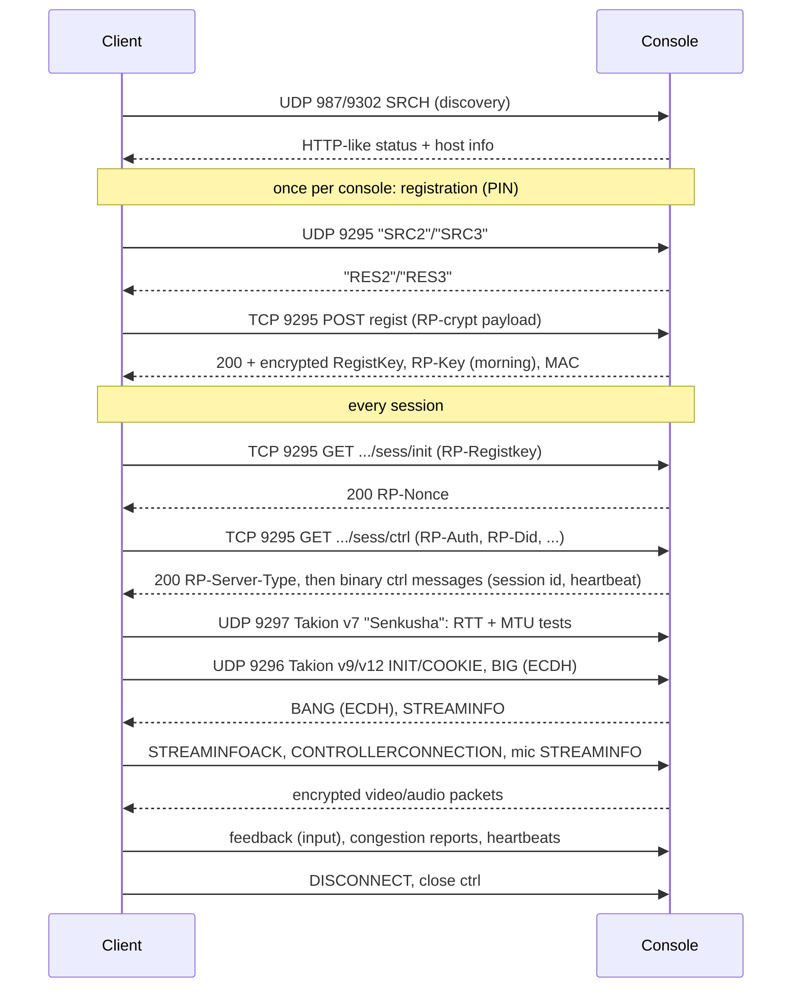

# PlayStation Remote Play protocol: clean-room specification

## Purpose

This document specifies the PlayStation Remote Play protocol (PS4 and PS5, LAN) so that DELOS can implement it
without reading or copying any existing implementation. It is untracked until the owner approves it.

| Item | Value |
|---|---|
| Spec author | Fable (Claude), 2026-11-21 |
| Implementer | The lead (Claude). Must not read Chiaki or chiaki-ng source code |
| Sources read by the author | chiaki-ng at commit `43728af` (2026-11-03, after tag `v1.10.1`; AGPL-3.0); jerasure `505ccb4b` and gf-complete `fa54a467` (BSD) for the FEC field definition; Sony support pages |
| Companion files | [ps-remote-play-constants.md](ps-remote-play-constants.md): extracted key tables. [ps-remote-play-test-vectors.json](ps-remote-play-test-vectors.json): test vectors |

### Clean-room rules for this document

- It describes behaviour, byte layouts, state machines and algorithms in the author's own words.
- It contains no source code and no struct definitions or comments copied from Chiaki.
- Interoperability facts are listed as facts: ports, magic strings, offsets, key tables, protobuf field numbers.

### Markers

- **[OBS]**: observed in chiaki-ng's behaviour. The console accepts it, but whether it is required is not proven.
- **[UNVERIFIED]**: not confirmed by any source or test.
- **[INFERENCE]**: the author's reasoning.
- **[LEGAL]**: a constant extracted from Sony software. The owner decides whether it may ship.

### Byte conventions

- BE = big-endian (network order); LE = little-endian.
- Offsets are hexadecimal from the start of the named buffer.
- "Text" means ASCII.

## 1. Overview

### 1.1 Sequence (LAN)



### 1.2 Ports

| Port | Transport | Use |
|---|---|---|
| 987 | UDP | PS4 discovery and wake |
| 9302 | UDP | PS5 discovery and wake |
| 9303–9319 | UDP, client side | Preferred local source port for discovery. Fall back to any port [OBS] |
| 9295 | UDP | Registration search (SRC2/SRC3) |
| 9295 | TCP | Registration POST, session init, ctrl channel |
| 9296 | UDP | Stream connection (Takion) |
| 9297 | UDP | Senkusha (network test, Takion v7) |

### 1.3 Targets and versions

The client tracks a target: which console and which RP-Version it speaks. Numeric codes are local labels only.

| Target | RP-Version string | Registration path | Session path prefix | Takion version (stream) |
|---|---|---|---|---|
| PS4, firmware < 7 | `8.0` | `/sce/rp/regist` | `/sce/rp/session` | 9 |
| PS4, firmware 7.x | `9.0` | `/sce/rp/regist` | `/sce/rp/session` | 9 |
| PS4, firmware ≥ 8 | `10.0` | `/sie/ps4/rp/sess/rgst` | `/sie/ps4/rp/sess/` | 9 |
| PS5 | `1.0` | `/sie/ps5/rp/sess/rgst` | `/sie/ps5/rp/sess/` | 12 |

- **Mapping from discovery's `system-version`** (a decimal string):
  - PS5 (protocol version `00030010`): ≥ 8050001 means `1.0`.
  - PS4 ≥ 8000000 means `10.0`; ≥ 7000000 means `9.0`; anything else means `8.0`.
- **Version negotiation:** if the session request fails and the response carries an `RP-Version` header different from the one sent, retry with the server's version.
  - Do this at most twice.
  - Reason codes 0x80108b11 (RP-Version) and 0x80108bff (unknown) qualify.
  - A server reporting `5.0` is treated as `9.0` [OBS].

### 1.4 Differences between PS4 and PS5

| Aspect | PS4 | PS5 |
|---|---|---|
| Codec | H.264 only (RP-Server-Type 0 or 1) | H.264, HEVC, HEVC HDR |
| Takion stream version | 9 | 12 (audio header has one extra byte, feedback state is 3 bytes longer) |
| Ctrl extra headers | — | `RP-StreamingType`, `RP-PadProcNo: 3` |
| Launch spec extras | — | `adaptiveStreamMode`, `videoCodec`, `dynamicRange` |
| Controller | DualShock 4 | DualSense (haptics, adaptive triggers) or DualShock 4 |

## 2. Discovery

All messages are text. Lines end with LF (`\n`), not CRLF. A trailing NUL byte is sent [OBS: the sent length is the text length + 1].

### 2.1 Search request

Broadcast or unicast to UDP 987 (PS4) or 9302 (PS5).

```text
SRCH * HTTP/1.1
device-discovery-protocol-version:<VER>
```

`<VER>` is `00020020` for PS4 and `00030010` for PS5.

### 2.2 Response

The response is an HTTP-style status line plus `key:value` header lines.

| Status | Meaning |
|---|---|
| 200 | Ready (on) |
| 620 | Standby (rest mode) |
| other | Unknown |

| Header | Meaning |
|---|---|
| `host-id` | Console id (12 hex characters; MAC-like) [UNVERIFIED format] |
| `host-name` | Console name |
| `host-type` | `PS4` or `PS5` [UNVERIFIED exact values] |
| `host-request-port` | TCP port for requests (normally 9295) |
| `system-version` | Decimal firmware code (see 1.3) |
| `device-discovery-protocol-version` | `00020020` or `00030010`. Decides PS4 or PS5 |
| `running-app-titleid`, `running-app-name` | Title currently running |

### 2.3 Wake from rest mode

Send this to the same port as the search.

```text
WAKEUP * HTTP/1.1
client-type:vr
auth-type:R
model:w
app-type:r
user-credential:<CRED>
device-discovery-protocol-version:<VER>
```

`<CRED>` comes from the stored registration key (section 3.6):
1. Take the key bytes up to the first NUL. They are ASCII hexadecimal text, at most 8 characters.
2. Parse that text as a hexadecimal number.
3. Write the number in decimal.

Test vector `wakeup_credential`: key text `1a2b3c4d` gives `439041101`.

## 3. Registration (pairing)

Registration runs once per console and user. It needs:
- the user's PSN account ID (8 bytes);
- the 8-digit PIN shown on the console:
  - PS5: Settings > System > Remote Play > Pair Device.
  - PS4: Settings > Remote Play Connection Settings > Add Device.

  The console must keep that screen open during registration.

### 3.1 PSN account ID via OAuth

The account ID is the user's numeric PSN user id, encoded in a specific way. It can be obtained from Sony's OAuth endpoints, or the user can enter it by hand (base64).

| Step | Request |
|---|---|
| 1. Sign-in page | Open in a browser (Android: Custom Tab; Apple: `ASWebAuthenticationSession`): `https://auth.api.sonyentertainmentnetwork.com/2.0/oauth/authorize` with query parameters `service_entity=urn:service-entity:psn`, `response_type=code`, `client_id=<CID>`, `redirect_uri=https://remoteplay.dl.playstation.net/remoteplay/redirect`, `scope=psn:clientapp referenceDataService:countryConfig.read pushNotification:webSocket.desktop.connect sessionManager:remotePlaySession.system.update`, `request_locale=en_US`, `ui=pr`, `service_logo=ps`, `layout_type=popup`, `smcid=remoteplay`, `prompt=always`, `PlatformPrivacyWs1=minimal` |
| 2. Capture code | The browser is redirected to the redirect URI with `?code=<CODE>`. Intercept that navigation and read `code` |
| 3. Token | `POST https://auth.api.sonyentertainmentnetwork.com/2.0/oauth/token`. Headers: `Authorization: Basic base64(<CID>:<SECRET>)`, `Content-Type: application/x-www-form-urlencoded`. Body: `grant_type=authorization_code&code=<CODE>&scope=<same scope>&redirect_uri=<same redirect>` (the reference also sends a trailing `&`). The JSON reply holds `access_token`, `refresh_token`, `expires_in` |
| 4. User id | `GET https://auth.api.sonyentertainmentnetwork.com/2.0/oauth/token/<access_token>` with the same Basic header. The JSON reply holds `user_id` as a decimal string |
| 5. Encode | Account ID = the user id as an unsigned 64-bit integer written in 8 bytes **little-endian**. The display and manual form is base64 of those 8 bytes (12 characters) |

- Refresh: `grant_type=refresh_token&refresh_token=<RT>&scope=...&redirect_uri=...` to the same token URL.
- Tokens are needed only for internet play (section 9). LAN needs only the account ID.
- No password is ever handled by the app.
- Test vector `account_id`: user id `1234567890123456789` gives the bytes `15 81 e9 7d f4 10 22 11`, base64 `FYHpffQQIhE=`.

**[LEGAL]** `<CID>` = `ba495a24-818c-472b-b12d-ff231c1b5745` and `<SECRET>` = `mvaiZkRsAsI1IBkY`.
- They are the OAuth credentials of Sony's own Remote Play client (third-party clients reuse them).
- Sony can revoke them at any time. Using them impersonates Sony's app.

### 3.2 RP crypto (used by registration, session and ctrl)

The "RP crypt" state has two 16-byte values:
- **bright**: the AES key;
- **ambassador**: the IV seed.

It also has the target.

- **IV for counter n:** the first 16 bytes of HMAC-SHA256(key = HMAC_KEY(target), message = ambassador ‖ n as 8-byte BE).
  - HMAC_KEY is HMAC_KEY_PS5 for PS5 `1.0` and HMAC_KEY_PS4_PRE10 for PS4 `8.0`/`9.0`.
  - Every other case uses HMAC_KEY_PS4, including a PS5 of unknown version [OBS].
  - The keys are in the constants file **[LEGAL]**.
- **Encrypt/decrypt with counter n:** AES-128 in CFB128 mode, key = bright, IV = IV(n), no padding.
  - Every call starts a fresh CFB stream at the IV of its counter.
  - Counters are chosen by the caller (see each use).

### 3.3 Registration search

1. Send the text `SRC2` (PS4) or `SRC3` (PS5) plus a NUL byte to UDP 9295 of the console. Broadcast is possible.
2. Wait up to 3 s for a datagram that starts with `RES2` / `RES3`. Its source address is the console.
3. If ICMP "port unreachable" comes back, the pairing screen is not open on the console.
4. Wait 100 ms; the PS4 does not accept the request immediately [OBS].
5. Connect TCP to the console port 9295 (timeout 3 s).

### 3.4 Registration request

The client sends an HTTP header, then the payload. The header lines are CRLF-terminated:

```text
POST <path> HTTP/1.1\r\n HTTP/1.1\r\n
HOST: 10.0.2.15\r\n
User-Agent: remoteplay Windows\r\n
Connection: close\r\n
Content-Length: <payload length>\r\n
RP-Version: <rp version>\r\n        (only for RP-Version 9.0 and later)
\r\n
```

Notes on the header [OBS]:
- The first line repeats ` HTTP/1.1\r\n` after the version; reproduce this literally.
- `HOST` is a fixed dummy address; for internet play it is the client's local address.

**Payload layout:**

| Offset | Size | Content |
|---|---|---|
| 0x000 | 0x1E0 | Filler bytes. The reference fills them with `0x41` ('A'); the protocol allows other values [OBS], but two key offsets are read from the filler (below) |
| inside filler | — | PS4 ≥10 / PS5: aeropause bytes 8..15 at 0xC7..0xCE and aeropause bytes 0..7 at 0x191..0x198. PS4 8.0/9.0: the 16-byte aeropause at 0x11C..0x12B |
| 0x1E0 | n | Inner header text, **encrypted** with RP crypt counter 0 |

**Key offsets:** `key0_off = payload[0x18D] & 0x1F` and `key1_off = payload[0x000] >> 3`. They are read from the filler before the aeropause bytes are written. With the `0x41` filler, `key0_off = 1` and `key1_off = 8`.

**Ambassador:** 16 random bytes, generated by the client.

**Registration RP crypt state:**

| Target | bright | ambassador |
|---|---|---|
| PS4 8.0/9.0 | REGIST_AES_KEY_PS4_PRE10 **[LEGAL]**, then bytes 0..3 XOR PIN as a 4-byte BE integer. The HMAC key is the PS4_PRE10 one | random ambassador |
| PS4 10.0 / PS5 | byte i = KEYS_0[i·32 + key0_off] (PS4 or PS5 table **[LEGAL]**), i = 0..15; then bytes 12..15 XOR PIN as 4-byte BE | random ambassador |

The PIN is the 8-digit number taken as an integer, for example 12345678 = 0x00BC614E.

**Aeropause** (it carries the ambassador to the console):

| Target | aeropause byte i (all arithmetic modulo 256) |
|---|---|
| PS4 8.0/9.0 | (ambassador[i] − i − 0x29) XOR ECHO_B[i] |
| PS4 10.0 | (ambassador[i] XOR KEYS_1_PS4[i·32 + key1_off]) + 0x29 + i |
| PS5 | (ambassador[i] XOR KEYS_1_PS5[i·32 + key1_off]) − 0x2D + i |

**Inner header** (text, CRLF lines):

| Target | Text |
|---|---|
| PS4 10.0 / PS5 | `Client-Type: dabfa2ec873de5839bee8d3f4c0239c4282c07c25c6077a2931afcf0adc0d34f\r\nNp-AccountId: <base64 account id>\r\n` **[LEGAL]** constant |
| PS4 8.0/9.0 | `Client-Type: Windows\r\nNp-AccountId: <base64>\r\n` |
| Very old PS4 (account by online id) | `Client-Type: Windows\r\nNp-Online-Id: <online id>\r\n` (legacy; not needed) |

The payload length is 0x1E0 + the length of the inner text.

### 3.5 Registration response

1. Read the HTTP response header (CRLF, blank line). Wait at most 3 s.
2. Check the status:
   - **Not 200:** read the header `RP-Application-Reason` as a hexadecimal number (codes in the table below).
   - **200:** read `Content-Length` bytes of body.
3. Decrypt the body with the **same** registration crypt state, counter 0.
4. The plaintext is a list of `Key: Value` CRLF lines:

| Key | Value | Use |
|---|---|---|
| `PS5-RegistKey` / `PS4-RegistKey` | Hex string. Decode it to bytes (≤ 16); the bytes are themselves ASCII hex text (typically 8 characters) [OBS] | Store. Used in session init and wake |
| `RP-Key` | 32 hex characters = 16 bytes (the "morning") | Store. Session key derivation |
| `PS5-Mac` / `PS4-Mac` | 12 hex characters = 6 bytes | Store |
| `PS5-Nickname` / `PS4-Nickname` | Console name | Store |
| `RP-KeyType` | Integer | Store [UNVERIFIED meaning] |
| `AP-Ssid`, `AP-Bssid`, `AP-Key`, `AP-Name` | Console Wi-Fi details | Not needed; do not store `AP-Key` (a secret) |
| `RP-SupportCmd` | Integer | Ignore [UNVERIFIED meaning] |

RegistKey, RP-Key and MAC are required. Fail if any is missing.

| `RP-Application-Reason` | Meaning |
|---|---|
| 0x80108b09 | Registration failed (usually a wrong PIN) |
| 0x80108b02 | Invalid PSN id |
| 0x80108b10 | Remote Play already in use |
| 0x80108b15 | Remote Play crashed on the console |
| 0x80108b11 | RP-Version mismatch |
| 0x80108bff | Unknown |

### 3.6 Stored per console

| Field | Size |
|---|---|
| Target (PS4/PS5 and RP-Version) | — |
| Registration key | ≤ 16 bytes, NUL-padded to 16 |
| Morning (RP-Key) | 16 bytes |
| Console MAC | 6 bytes |
| Nickname | text |
| Host id (from discovery) | text |
| Account ID used | 8 bytes |

**Secrets:** the registration key and the morning are credentials. Store them in Android Keystore-backed encrypted storage or the Apple Keychain.

## 4. Session start

### 4.1 Session init request

Open a TCP connection to the console port 9295 (timeout 5 s) and send:

```text
GET <prefix>init HTTP/1.1\r\n          (PS4 8.0/9.0: GET /sce/rp/session HTTP/1.1)
Host: <console ip>:9295\r\n
User-Agent: remoteplay Windows\r\n
Connection: close\r\n
Content-Length: 0\r\n
RP-Registkey: <hex of the registration key bytes up to the first NUL>\r\n
Rp-Version: <rp version>\r\n
\r\n
```

The response is an HTTP header (timeout 5 s):
- **Success:** status 200 and an `RP-Nonce` header holding base64 of exactly 16 bytes (the **nonce**).
- **Failure:** `RP-Application-Reason` (hex; table 3.5) and possibly `RP-Version` (see 1.3).

Close the connection afterwards.

### 4.2 Session RP crypt

Compute bright and ambassador from the nonce and the stored morning (all arithmetic modulo 256; the tables are **[LEGAL]**).

| Target | ambassador byte i | bright byte i |
|---|---|---|
| PS4 8.0/9.0 | (nonce[i] − i − 0x27) XOR ECHO_A[i] | ((morning[i] − i + 0x34) XOR ECHO_B[i]) XOR nonce[i] |
| PS4 10.0 | (nonce[i] + 0x36 + i) XOR A[i] | ((B[i] XOR morning[i]) + 0x21 + i) XOR nonce[i] |
| PS5 | (nonce[i] − 0x2D − i) XOR A[i] | ((morning[i] + 0x18 + i) XOR nonce[i]) XOR B[i] |

For PS4 10.0 and PS5:
- `A` = row `nonce[0] >> 3` of KEYS_A (PS4/PS5);
- `B` = row `nonce[7] >> 3` of KEYS_B (PS4/PS5).

Test vectors: `session_ps4_9`, `session_ps4_10`, `session_ps5_1`.

### 4.3 Device id (DID)

The DID is 32 bytes, generated per session:

| Bytes | Content |
|---|---|
| 0–9 | `00 18 00 00 00 07 00 40 00 80` [OBS] |
| 10–25 | 16 random bytes |
| 26–31 | zero |

### 4.4 Ctrl request

1. Wait about 10 ms after the session init [OBS: the PS4 does not always react at once].
2. Open a **new** TCP connection to port 9295 (timeout 5 s).

Ctrl keeps two RP-crypt counters: **local** (starts at 0, for what the client sends) and **remote** (starts at 0, for what the console sends). Each encrypted item uses the next counter value.

| Header value | Plaintext | Local counter |
|---|---|---|
| `RP-Auth` | Registration key, 16 bytes NUL-padded | 0 |
| `RP-Did` | DID, 32 bytes | 1 |
| `RP-OSType` | `Win10.0.0` + NUL (10 bytes) | 2 |
| `RP-StartBitrate` (RP-Version 10.0 and PS5 only) | 4 zero bytes | 3 |
| `RP-StreamingType` (PS5 only) | uint32 LE: 1 = H.264, 2 = HEVC, 3 = HEVC HDR | 4 |

Each value is base64 of the RP-crypt **encrypted** bytes. The request:

```text
GET <prefix>ctrl HTTP/1.1\r\n          (PS4 8.0/9.0: /sce/rp/session/ctrl)
Host: <console ip>:9295\r\n
User-Agent: remoteplay Windows\r\n
Connection: keep-alive\r\n
Content-Length: 0\r\n
RP-Auth: <b64>\r\n
RP-Version: <rp version>\r\n
RP-Did: <b64>\r\n
RP-ControllerType: 3\r\n
RP-ClientType: 11\r\n
RP-OSType: <b64>\r\n
RP-ConPath: 1\r\n
RP-PadProcNo: 3\r\n                   (PS5 only; without it some DualSense trigger effects arrive in an unusable form [OBS])
RP-StartBitrate: <b64>\r\n            (when present)
RP-StreamingType: <b64>\r\n           (when present)
\r\n
```

- If no response arrives within 5 s, reconnect once and resend [OBS].
- **Response:** status 200 means success. Headers:
  - `RP-Server-Type`: base64 of 16 bytes. Decrypt with **remote counter 0**. Byte 0: 0 = PS4, 1 = PS4 Pro, 2 = PS5.
    - On 0 (PS4), a 1080p request should fall back to 720p.
    - On 0 or 1 (PS4 / PS4 Pro), any codec other than H.264 falls back to H.264.
  - `RP-Prohibit: 1`: the current content cannot be streamed (show a notice).
- Bytes after the header belong to the binary ctrl stream (4.5).

Test vector `ctrl_headers_ps5`: header values for a known key, DID and session.

### 4.5 Ctrl binary messages

These go on the same TCP connection, in both directions.

| Offset | Size | Field |
|---|---|---|
| 0 | 4 | Payload length (BE) |
| 4 | 2 | Message type (BE) |
| 6 | 2 | 0 |
| 8 | n | Payload. Encrypted with RP crypt (local counter when sending, remote counter when receiving); one counter per message with a non-empty payload |

- Messages with an empty payload do not consume a counter.
- Local counters continue after the request headers (the next is 3, 4 or 5 depending on the headers sent).
- The remote counter continues at 1 after `RP-Server-Type`; it stays at 0 if that header was absent [OBS].

| Type | Direction | Name | Payload |
|---|---|---|---|
| 0x0033 | C ← P | SESSION_ID | Byte 0 is normally 0x4A [OBS], then an alphanumeric ASCII id of 24..78 characters. Store it; it is the `session_key` of BIG (section 5.4) |
| 0x00FE | C ← P | HEARTBEAT_REQ | Empty. Answer with 0x01FE |
| 0x01FE | C → P | HEARTBEAT_REP | Empty. The console ends the session after about 30 s without replies [OBS] |
| 0x0004 | C ← P | LOGIN_PIN_REQ | Empty. The console wants the user's sign-in passcode (account lock). It is only valid before SESSION_ID |
| 0x8004 | C → P | LOGIN_PIN_REP | The passcode digits as ASCII [UNVERIFIED encoding] |
| 0x0005 | C ← P | LOGIN | 1 byte: 0 = success, 1 = passcode wrong (ask again) |
| 0x0050 | C → P | GOTO_BED | Empty. Puts the console into rest mode |
| 0x0014 | C → P | GO_HOME | 16 bytes `00 FF 00…00`. Shows the home screen |
| 0x0013 | C → P | ENABLE_DUALSENSE | 3 bytes `00 40 00` |
| 0x0011 | C → P | (DualSense connect) | 16 bytes `a0 ab 51 bd d1 7e 00 00 ff ff ff ff ff 00 00 00` [OBS][LEGAL] |
| 0x000D | C → P | KEYBOARD_ENABLE | 16 bytes `00 00 00 01 00 00 05 ae 00…00` [OBS] |
| 0x0020 | C → P | KEYBOARD_ENABLE_TOGGLE | 1 byte `01` |
| 0x0021 | C ← P | KEYBOARD_OPEN | 0x1C unknown bytes, uint32 BE text length, text |
| 0x0022 | C ← P | KEYBOARD_CLOSE_REMOTE | Ignore the payload |
| 0x0023 | C → P | KEYBOARD_TEXT_CHANGE_REQ | uint32 BE counter (incrementing from 1), uint32 BE length, 8 zero bytes, 16 zero bytes, uint32 BE length, UTF-8 text |
| 0x0024 | C ← P | KEYBOARD_TEXT_CHANGE_RES | uint32 counter, uint32, uint32 BE length, uint32, 16 bytes, uint32, uint32, text |
| 0x0025 | C → P | KEYBOARD_CLOSE_REQ | 4 bytes: `00 00 00 00` accept, `00 00 00 01` reject |
| 0x0030 | C → P | MIC_CONNECT | 2 bytes `00 00` |
| 0x0036 | C → P | MIC_TOGGLE | 4 bytes `00 01 <1 = unmuted, 0 = muted> 59` [OBS] |
| 0x0910 | C → P | DISPLAY_DEVICES | 4 zero bytes [OBS] |
| 0x0001 | C ← P | DISPLAY_A | Byte 0 = 1: protected content starts; 0: it ends |
| 0x0016 | C ← P | DISPLAY_B | Together with DISPLAY_A. `01 FF` clears the state [OBS] |
| 0x0034 | both | SWITCH_TO_STREAM_CONNECTION | Internet play only (section 9) |

**After SESSION_ID** [OBS]:
1. If a DualSense is used, send 0x0013, then 0x0011.
2. Optionally send 0x000D and 0x0020 (keyboard).
3. Send 0x0036 `00 01 01 59` twice.
4. Send 0x0910 `00 00 00 00`.

**Timeouts and fallback:**
- Wait up to 10 s after the ctrl request for SESSION_ID or LOGIN_PIN_REQ.
- If no SESSION_ID arrives, the client may build its own [OBS]: the decimal monotonic seconds, followed by base64 of 48 random bytes.
- The session then continues.

## 5. Stream transport (Takion)

Takion is an SCTP-like protocol over UDP. One UDP socket is connected to the console, port 9296 for the stream and 9297 for Senkusha.
- Receive buffer: 0x19000 bytes.
- Set "don't fragment" when the measured MTU is used.

### 5.1 Datagram type

The low nibble of byte 0 is the packet type. Bit 4 of byte 0 on AV packets is a flag (5.6).

| Type | Name | Direction |
|---|---|---|
| 0 | CONTROL (chunks) | both |
| 1 | FEEDBACK_HISTORY | C → P |
| 2 | VIDEO | P → C |
| 3 | AUDIO | both (P → C sound and haptics, C → P microphone) |
| 4 | HANDSHAKE | unused [UNVERIFIED] |
| 5 | CONGESTION | C → P |
| 6 | FEEDBACK_STATE | C → P |
| 8 | CLIENT_INFO | unused [UNVERIFIED] |

### 5.2 CONTROL packet

| Offset | Size | Field |
|---|---|---|
| 0x00 | 1 | 0x00 |
| 0x01 | 4 | Tag (BE). The receiver's tag: in packets the client sends, the console's tag (0 in the first INIT); in received packets, the client's own tag. Drop received packets with a wrong tag |
| 0x05 | 4 | GMAC (5.5) |
| 0x09 | 4 | Key position, low 32 bits (BE) |
| 0x0D | 1 | Chunk type |
| 0x0E | 1 | Chunk flags |
| 0x0F | 2 | Chunk length (BE) = payload length + 4 |
| 0x11 | n | Chunk payload |

The datagram length must equal 0x0D + chunk length.

| Chunk type | Name | Payload |
|---|---|---|
| 0x00 | DATA | 5.3 |
| 0x01 | INIT | tag (4), a_rwnd (4), outbound streams (2), inbound streams (2), initial sequence number (4); all BE |
| 0x02 | INIT_ACK | Same 16 bytes + 32-byte cookie |
| 0x03 | DATA_ACK | Cumulative TSN (4), a_rwnd (4), gap-block count (2), duplicate count (2); all BE. The reference only accepts 12-byte acks (no gap blocks) |
| 0x0A | COOKIE | 32-byte cookie echoed from INIT_ACK |
| 0x0B | COOKIE_ACK | Empty |

**Handshake:**
1. The client picks a random 32-bit tag. Its first TSN is that same value.
2. Send INIT with header tag 0 and key position 0. Values: tag, a_rwnd 0x19000, 100 outbound, 100 inbound, initial TSN = tag.
3. Wait 5 s for INIT_ACK; try at most 3 times.
4. Check the INIT_ACK:
   - its tag is non-zero;
   - outbound streams ≤ 100 and > 0;
   - inbound streams ≥ 100.
5. Use the INIT_ACK tag as the console's tag in every later packet. The console's first TSN equals **its tag**, not the initial-TSN field [OBS].
6. Send COOKIE; wait for COOKIE_ACK (3 tries, 5 s). If a duplicate INIT_ACK arrives first, read the next datagram.
7. Takion is connected. No encryption exists yet: the GMAC field is zero until section 5.5's keys exist.

Test vector `takion_init_packet`: INIT with tag 0x11223344.

### 5.3 DATA chunks

| Offset in payload | Size | Field |
|---|---|---|
| 0 | 4 | TSN (BE), +1 per DATA chunk sent |
| 4 | 2 | Channel (BE) |
| 6 | 2 | 0 |
| 8 | 1 | Data type, only in the first fragment of a message |
| 9 | n | Data |

| Data type | Content |
|---|---|
| 0 | Protobuf `TakionMessage` (5.4) |
| 7 | Rumble (8.4) |
| 9 | Pad info (8.4) |
| 11 | Trigger effects (8.4) |

Chunk flags:
- `1`: a complete message, or the last fragment.
- `0`: a non-final fragment.

| Channel | Used for [OBS] |
|---|---|
| 1 | General messages (BIG, heartbeat, controller connection, mic stream info, disconnect, Senkusha set-up) |
| 2 | CORRUPTFRAME, IDRREQUEST |
| 8 | Senkusha commands |
| 9 | STREAMINFOACK |

**Fragmentation** (needed for BIG, which exceeds one datagram):
- Let `m = min(mtu_in, mtu_out) − 50`.
- While the message does not fit, send chunks.
  - The first chunk carries the data type byte and `m − 26` data bytes, flag 0.
  - Following chunks omit the data type byte and carry `m − 25` bytes, flag 0.
- The last chunk has flag 1.

**Reliability:**
- The receiver delivers DATA in TSN order through a reorder window of 16 entries.
- After each in-order delivery batch it sends one DATA_ACK with the highest delivered TSN.
- The sender keeps unacknowledged DATA, up to 1024 entries, and resends the identical datagram (same key position and GMAC) every 200 ms. It gives up after 25 resends.
- A DATA_ACK acknowledges every TSN ≤ its cumulative TSN (serial-number arithmetic, RFC 1982).

### 5.4 Protobuf messages

The schema is proto2, package name free. Field numbers are interoperability facts. Every `TakionMessage` has:
- a required `type` (field 1, enum);
- at most one payload field.

| `type` value | Name | Payload field (number) |
|---|---|---|
| 0 | BIG | big_payload (2) |
| 1 | BANG | bang_payload (3) |
| 2 | INFO | info_payload (4) |
| 3 | HEARTBEAT | — |
| 4 | PACKETLOSS | loss_payload (5) |
| 5 | CORRUPTFRAME | corrupt_payload (6) |
| 6 | CURSOR | cursor_payload (8) |
| 7 | TIMER | timer_payload (9) |
| 8 | DISCONNECT | disconnect_payload (10) |
| 9 | LOG | log_payload (11) |
| 10 | HEADERREQUEST | header_payload (12) |
| 11 | DEBUG | debug_payload (13) |
| 12 | SENKUSHA | senkusha_payload (14) |
| 13 | STREAMINFO | stream_info_payload (15) |
| 14 | STREAMINFOACK | — |
| 15 | XMBCOMMAND | xmb_command_payload (16) |
| 16 | CONNECTIONQUALITY | connection_quality_payload (17) |
| 17 | CLIENTMETRIC | client_metric_payload (18) |
| 18 | PLAYTIMELEFT | play_time_left_payload (19) |
| 19 | SERVERMESSAGE | server_message_payload (20) |
| 20 | FPSCHANGE | fps_change_payload (21) |
| 21 | CONTROLLERCONNECTION | controller_connection_payload (22) |
| 22 | CLIENTINFO | client_info_payload (23) |
| 23 | VIDEOCAPTURE | video_capture_payload (24) |
| 24 | AUDIOCAPTURE | audio_capture_payload (25) |
| 25 | IDRREQUEST | — |
| 26 | GKTRACE | gk_trace_payload (26) |
| 27 | PERIODICTIMESTAMP | periodic_timestamp_payload (27) |
| 28 | SERVERSETTINGS | server_settings_payload (28) |
| 29 | DIRECTMESSAGE | direct_message_payload (29) |
| 30 | MICCONNECTION | mic_connection_payload (30) |
| 31 | TAKIONPROTOCOLREQUEST | takion_protocol_request (31) |
| 32 | TAKIONPROTOCOLREQUESTACK | takion_protocol_request_ack (32) |

The payload messages DELOS needs are below. All fields are proto2; "req" means required.

| Message | Fields (number: type name) |
|---|---|
| BigPayload | 1: req uint32 client_version; 2: req string session_key; 3: req string launch_spec; 4: req bytes encrypted_key; 5: bytes ecdh_pub_key; 6: bytes ecdh_sig |
| BangPayload | 1: req uint32 server_version; 2: req uint32 token; 3: req bool encrypted_key_accepted; 4: req bool version_accepted; 5: req string session_key; 6: EventCode extended_info; 7: string server_version_string; 8: bytes ecdh_pub_key; 9: bytes ecdh_sig |
| EventCode | 1: req string event_code; 2: string name; 3: string description |
| StreamInfoPayload | 1: repeated ResolutionPayload resolution; 2: req bytes audio_header; 3: uint32 start_timeout; 4: uint32 afk_timeout; 5: uint32 afk_timeout_disconnect; 6: uint32 congestion_control_interval; 7: repeated AudioChannelPayload audio_channel |
| ResolutionPayload | 1: req uint32 width; 2: req uint32 height; 3: req bytes video_header |
| AudioChannelPayload | 1: req uint32 audio_channel_type; 2: req bytes audio_header; 3: bool is_raw_pcm |
| DisconnectPayload | 1: req string reason; 2: EventCode extended_info |
| CorruptFramePayload | 1: req uint32 start; 2: req uint32 end |
| PacketLossPayload | 1: req uint32 start; 2: req uint32 end; 3: req uint32 packets_received |
| ConnectionQualityPayload | 1: uint32 target_bitrate; 2: uint32 upstream_bitrate; 3: float upstream_loss; 4: bool disable_upstream_audio; 5: double rtt; 6: uint64 loss |
| ControllerConnectionPayload | 1: int32 controller_id; 2: bool connected; 3: enum controller_type (0 NOTSET, 1 DUALSHOCK3, 2 DUALSHOCK4, 3 VITA, 4 XINPUT, 5 MOBILE, 6 DUALSENSE, 7 VR2SENSE) |
| FpsChangePayload | 1: req uint32 fps |
| TimerPayload | 1: req uint32 seconds_left; 2: req uint32 total_seconds |
| PlayTimeLeftPayload | 1: uint32 time_left; 2: string reason |
| ServerSettingsPayload | 1: uint32 idr_period; 2: bool send_periodic_timestamp |
| MicConnectionPayload | 1: req int32 controller_id; 2: req bool connected; 3: bool result |
| TakionProtocolRequestPayload | 1: repeated uint32 supported_takion_versions |
| TakionProtocolRequestAckPayload | 1: uint32 takion_protocol_version |
| InfoPayload | 1..13: req uint32 effective_bw, bitrate, min_bitrate, target_bitrate, corrupt_frame_freq, mtu, fps, monitor_interval, ext_overhead, int_overhead, timeout_interval, min_resume_quality, min_fps |
| SenkushaPayload | 1: req enum command (0 ECHO, 1 MTU, 3 BANDWIDTH, 4 CLIENT_MTU); 2: SenkushaEchoCommand; 3: SenkushaMtuCommand; 4: SenkushaBandwidthCommand; 5: SenkushaClientMtuCommand |
| SenkushaEchoCommand | 1: req bool state |
| SenkushaMtuCommand | 1: req uint32 id; 2: req uint32 mtu_req; 3: uint32 mtu_sent; 4: uint32 num; 5: uint32 send_delay; 6: uint32 delta |
| SenkushaClientMtuCommand | 1: req uint32 id; 2: req uint32 mtu_req; 3: req bool state; 4: uint32 mtu_down |
| SenkushaBandwidthCommand | 1: req uint32 id; 2: req uint32 time; 3: uint32 bandwidth; 4: uint32 fps; 5: uint32 mtu; 6: uint32 nalu_count; 7: uint32 total_sent; 8: bool upstream; 9: double loss |

The full list of the remaining messages (cursor, log, client metric, deep link, mic info) is not needed for streaming. It can be added on request.

### 5.5 Stream encryption ("GK crypt")

The keys are established after BIG/BANG (section 6.1).
- `handshake_key`: 16 random bytes per session, generated by the client.
- `secret`: the 32-byte ECDH shared secret.

**Per direction:** index 2 is the client's sending direction and index 3 the console's.
- `H = HMAC-SHA256(key = secret, message = 01 ‖ index ‖ 00 ‖ handshake_key ‖ 01 00)`.
- `key` = H[0..15]; `iv` = H[16..31].

**Keystream:** block n (16 bytes) = AES-128-ECB(key, iv + n). Here "+" adds n to `iv` read as a 128-bit **little-endian** integer, modulo 2^128. The keystream byte at position p is byte (p mod 16) of block ⌊p/16⌋.

**Encrypt/decrypt** data at key position p: XOR with keystream bytes p, p+1, … (no block alignment needed).

**GMAC key** g(i):
- g(0) = fold(SHA-256(key ‖ iv)).
- g(i) for i > 0 = fold(SHA-256(g(0) ‖ (iv + i·44910))). The addition is little-endian as above.
- fold(x) = x[0..15] XOR x[16..31].

**GMAC of a datagram** with key position p:
- key index i = ⌊(max(p,1) − 1) / 45000⌋;
- GCM IV = iv + ⌊p/16⌋ (16 bytes, a non-96-bit GCM IV);
- run AES-128-GCM with key g(i), that IV, the datagram as AAD and an empty plaintext;
- the MAC is the first 4 bytes of the tag.

**Computing or checking a MAC:**
1. Set the MAC field of the datagram to zero.
2. For CONTROL and CONGESTION datagrams, also zero the 4-byte key position field.
3. Compute the GMAC over the whole datagram.
4. Write it into the MAC field, and restore the key position field.

**Key position (sender):** a 64-bit byte counter per direction that starts at 0 and stays 0 until the GK keys exist
(so BIG and all Senkusha packets carry 0). Each sent packet takes the current value as its key position and advances
the counter by `s + (s mod 16)` [OBS: not a round-up to 16], where s is:
- DATA chunk: the length of the message data (without Takion headers);
- DATA_ACK: 29 (the whole datagram);
- CONGESTION: 15 (the whole datagram);
- FEEDBACK_STATE, FEEDBACK_HISTORY, microphone AUDIO: encrypted payload length + 16. Their payload is encrypted at
  key position + 16.

Only the low 32 bits are on the wire.
- **[INFERENCE]** The console mainly needs positions that increase and that match the keystream used. The exact spacing rule above is observed, not proven necessary.

**Key position (receiver):** extend the received low 32 bits to 64 bits with the last accepted value as the reference (wrap-around detection, RFC 1982). Commit the new value only after the MAC verifies (AV and control).

- Before GK keys exist, outgoing MACs are zero and incoming MACs are not checked.
- AV packets received before the keys exist are kept, up to 32, and processed once the keys exist.

Test vectors `gk_index2`, `gk_index3`: key, iv, g(0), g(1), keystream, GMACs at positions 0, 0x30 and 45001.

### 5.6 AV packet (types 2 and 3) as received (Takion v9 and v12)

| Offset | Size | Field |
|---|---|---|
| 0x00 | 1 | Low nibble: type. Bit 4: "NALU info" flag |
| 0x01 | 2 | Packet index (BE). Video: a running packet counter; audio: per packet |
| 0x03 | 2 | Frame index (BE) |
| 0x05 | 4 | Unit word (BE), see below |
| 0x09 | 1 | Codec (audio: 5 = Opus) [video values UNVERIFIED] |
| 0x0A | 4 | GMAC |
| 0x0E | 4 | Key position, low 32 bits |
| Video: 0x12 | 2 | Unknown word |
| Video: 0x14 | 1 | Bits 7..5: adaptive stream index (selects the resolution profile); low bits unknown |
| Video: 0x15 | — | Payload starts here (at 0x18 if the NALU flag is set; the 3 skipped bytes are unknown) |
| Audio: 0x12 | 1 | Unknown |
| Audio v9: 0x13 | — | Payload (at 0x16 if the NALU flag is set) |
| Audio v12: 0x13 (0x16 with NALU flag) | 1 | 0x02 = DualSense haptics data, otherwise sound |
| Audio v12: following byte | — | Payload |

The v9/v12 header is the v7 header (5.7) extended by the same video bytes; only the MAC field (v7: zero) and the
audio marker byte (v12) differ. Offsets come from the reference parser [OBS]; confirm them against a capture (Q1).

**Unit word:**

| Kind | Bits |
|---|---|
| Video | unit index = bits 31..21; (units in frame − 1) = bits 20..10; FEC units = bits 9..0 |
| Audio | unit index = bits 31..24; (units in frame − 1) = bits 23..16; low 16 bits = audio unit descriptor (9.2) |

**Payload decryption:** XOR with the console's keystream (index 3) starting at **key position + 16**. The MAC uses the key position itself.

**Reordering:**
- Video packets go through a reorder window of 64 entries keyed by the 16-bit packet index. It starts at packet index − unit index of the first packet seen.
- If the head is missing, wait at most 16 ms (about one frame at 60 fps), then skip to the next packet present.
- Audio is not reordered.

### 5.7 Takion v7 (Senkusha only, no encryption)

The AV header is 0x12 bytes:

| Offset | Size | Field |
|---|---|---|
| 0x00 | 1 | Type |
| 0x01 | 2 | Packet index |
| 0x03 | 2 | Frame index |
| 0x05 | 4 | Unit word, video layout |
| 0x09 | 1 | Codec |
| 0x0A | 4 | 0 |
| 0x0E | 4 | Key position, unconverted, 0 [OBS] |

Video packets have 3 extra bytes: word, then adaptive index << 5. The NALU flag adds 3 more zero bytes.

### 5.8 CONGESTION packet (type 5, 15 bytes)

| Offset | Size | Field |
|---|---|---|
| 0x00 | 1 | 0x05 |
| 0x01 | 2 | 0 |
| 0x03 | 2 | Packets received in the interval (BE) |
| 0x05 | 2 | Packets lost in the interval (BE) |
| 0x07 | 4 | GMAC |
| 0x0B | 4 | Key position, low 32 bits |

Send every 200 ms.

**Received and lost** are the sums over the interval of:
- video: per frame, the units received and the units missing (source + FEC);
- audio: the packets counted against the frame-index range.

The console adapts its bitrate to the reported loss. Clamping the reported loss to a maximum (for example 3 % on LAN) keeps the bitrate high on links with sporadic loss; a user setting is advisable [OBS].

### 5.9 Clarifications (2026-11-21, answers to the implementer)

| # | Question | Answer |
|---|---|---|
| 1 | Are CONTROL DATA chunk payloads encrypted with the GK keystream? | **No, in both directions.** DATA chunks (protobuf BIG, BANG, STREAMINFO, HEARTBEAT, DISCONNECT, and data types 7, 9, 11) travel as plaintext. After the keys exist they are only authenticated with the GMAC (5.5). The GK keystream is applied only to AV payloads (received), FEEDBACK_STATE, FEEDBACK_HISTORY and microphone AUDIO (sent). The key position of a DATA chunk only feeds the GMAC IV and key index [OBS] |
| 2 | DATA_ACK? | Same: plaintext, GMAC only, key position zeroed during the MAC computation (it is a CONTROL packet) [OBS] |
| 3 | PS5 reports `host-request-port: 997`; which port do the requests use? | The reference ignores `host-request-port` and always uses **9295**: UDP SRC3/SRC2 search, TCP registration POST, TCP session init and TCP ctrl. Takion uses 9296 and Senkusha 9297, also fixed [OBS]. What listens on 997 is unknown [UNVERIFIED]. Use 9295. If 9295 refuses on a real PS5, try the reported port as a fallback and record the result in this table |
| 4 | Does the stream connection work without Senkusha? | **[UNVERIFIED].** The reference always runs Senkusha first. Its fallback values (mtu 1454 in/out, rtt 1 ms, "don't fragment" off) are only used after Senkusha was *attempted* and failed. Whether the console requires a prior Senkusha session is not known. Recommendation: test the skip first, because it is cheap. If BIG gets no BANG, or STREAMINFO never arrives, implement Senkusha (6.4), at least steps 1–3 (protocol request, BIG, BANG) and the disconnect |
| 5 | Field order of a CONTROL DATA packet sent by the client; tag and MAC rule | Confirmed (below) |

**Answer 5: CONTROL packet sent by the client**, in order:

| Offset | Field |
|---|---|
| 0x00 | `00` |
| 0x01..0x04 | Tag = the **console's** tag from INIT_ACK (BE). It is 0 only in the very first INIT |
| 0x05..0x08 | GMAC |
| 0x09..0x0C | Key position, low 32 bits (BE) |
| 0x0D | Chunk type |
| 0x0E | Chunk flags |
| 0x0F..0x10 | Chunk length = payload + 4 (BE) |
| 0x11.. | Payload (DATA: TSN, channel, 0, data type, data) |

**MAC computation:**
1. Build the packet with its real key position.
2. Copy it and set bytes 0x05..0x0C to zero (the MAC **and** the key position).
3. Compute the GMAC over the whole copy with the key position value (5.5).
4. Write the 4-byte result to 0x05.
5. Keep the real key position at 0x09.

The receiver does the same with its received bytes. Before the GK keys exist, the MAC field and the key position are 0 and no MAC is computed.

## 6. Stream connection state machine (UDP 9296)

### 6.1 BIG and BANG

1. Connect Takion (5.2). Takion version: 9 for PS4, 12 for PS5.
2. Generate `handshake_key` (16 random bytes) and an ECDH key pair on **secp256k1**.
3. Send BIG (channel 1, fragmented per 5.3):

| BIG field | Value |
|---|---|
| client_version | 9 (PS4) or 12 (PS5) |
| session_key | Session id from ctrl (4.5) |
| launch_spec | base64 of the encrypted launch spec (6.2) |
| encrypted_key | 4 zero bytes |
| ecdh_pub_key | Uncompressed point, 65 bytes (`04 ‖ X ‖ Y`) |
| ecdh_sig | HMAC-SHA256(key = handshake_key, message = ecdh_pub_key), 32 bytes |

4. Wait up to 5 s for BANG. If STREAMINFO arrives first, keep it and process it after BANG.
5. On BANG:
   - Require `version_accepted` and `encrypted_key_accepted`.
   - Shared secret = the 32-byte X coordinate of ECDH(own private key, BANG `ecdh_pub_key`).
   - Create GK crypt index 2 (send) and index 3 (receive) (5.5).
   - **Verification of BANG `ecdh_sig`:** chiaki-ng does not check it. A check of HMAC-SHA256(handshake_key, console pub key) is plausible but **[UNVERIFIED]**; do not fail the session on it until confirmed against a console.
6. A DISCONNECT instead of BANG ends the session with its reason.

Test vector `ecdh`: fixed keys, public points, shared secret, client signature.

### 6.2 Launch spec

The launch spec is a JSON document, in this field order [OBS]:

| Key | Value |
|---|---|
| sessionId | `"sessionId4321"` |
| streamResolutions | `[{"resolution":{"width":W,"height":H},"maxFps":F,"score":10}]` |
| network | `{"bwKbpsSent":KBPS,"bwLoss":0.001000,"mtu":MTU_IN,"rtt":RTT_MS,"ports":[53,2053]}` |
| slotId | 1 |
| appSpecification | `{"minFps":30,"minBandwidth":0,"extTitleId":"ps3","version":1,"timeLimit":1,"startTimeout":100,"afkTimeout":100,"afkTimeoutDisconnect":100}` |
| konan | `{"ps3AccessToken":"accessToken","ps3RefreshToken":"refreshToken"}` |
| requestGameSpecification | `{"model":"bravia_tv","platform":"android","audioChannels":"5.1","language":"sp","acceptButton":"X","connectedControllers":["xinput","ds3","ds4"],"yuvCoefficient":"bt601","videoEncoderProfile":"hw4.1","audioEncoderProfile":"audio1"` + PS5 only `,"adaptiveStreamMode": "resize"` + `}` |
| userProfile | `{"onlineId":"psnId","npId":"npId","region":"US","languagesUsed":["en","jp"]}` |
| videoCodec (PS5 only) | `"avc"` or `"hevc"` |
| dynamicRange (PS5 only) | `"SDR"` or `"HDR"` |
| handshakeKey | base64 of handshake_key |

Notes:
- The reference writes the JSON compactly; the PS5 extras appear exactly as `"videoCodec":"hevc",` and `"dynamicRange":"SDR",` before `"handshakeKey"`.
- **[UNVERIFIED]** which keys the console really requires; start with the full document.

**Encryption:**
1. Take the JSON text plus one NUL byte, length L.
2. Compute K = RP-crypt-encrypt(L zero bytes) with the session RP crypt at **counter 0**.
3. Ciphertext = JSON ‖ NUL, XOR K.
4. Base64 it.

Note: this is the CFB keystream of zeros, **not** CFB encryption of the JSON. The two differ after the first block. Counter 0 is the same counter ctrl used for `RP-Auth`; this reuse is how the protocol works.

Test vector `launchspec_keystream_ps5`.

### 6.3 STREAMINFO and after

1. **STREAMINFO from the console:**
   - `resolution` entries: width, height and `video_header`, the codec parameter sets in Annex-B: SPS + PPS for H.264; VPS + SPS + PPS for HEVC [OBS: only SPS/VPS checked].
   - `audio_header`: 14 bytes (7.1).
   - Wait up to 5 s.
2. Send STREAMINFOACK (type 14 only) on channel 9.
3. Send CONTROLLERCONNECTION on channel 1: `connected = true`, `controller_type` = 6 (DualSense) or 2 (DualShock 4); `controller_id` unset.
4. Send STREAMINFO on channel 1 with only `audio_header` = the microphone format: channels 1, bits 16, rate 48000, frame size 480, last field 1 (7.1).
5. Start input feedback (section 8) and congestion reports (5.8).
6. Every 1 s, send HEARTBEAT (type 3) on channel 1.

**Messages from the console during the stream:**

| Message | Handling |
|---|---|
| DISCONNECT | Stop; show the reason (for example `Server shutting down`) |
| CONNECTIONQUALITY | Statistics (target bitrate, RTT, loss) |
| CORRUPTFRAME, STREAMINFOACK | Log |
| Data types 7, 9, 11 | Section 8.4 |

**Teardown:** send DISCONNECT with reason `Client Disconnecting` on channel 1, close Takion, then close the ctrl TCP connection.

### 6.4 Senkusha (UDP 9297, before the stream)

It measures RTT and MTU, which feed the launch spec and BIG fragmentation. Every step waits up to 5 s unless noted.

1. Takion v7 handshake, without encryption (connect timeout 30 s).
2. Send TAKIONPROTOCOLREQUEST `supported_takion_versions = [9]` [OBS: 9 also for a PS5] on channel 1. Wait for TAKIONPROTOCOLREQUESTACK.
3. Send BIG with client_version 9 and empty `session_key`, `launch_spec` and `encrypted_key`. Wait for BANG.
4. **RTT test:**
   1. Send SENKUSHA ECHO state=true on channel 8 and wait for its DATA_ACK.
   2. Send 10 pings. Each is a v7 audio AV datagram of 0x224 bytes:
      - codec 0xFF, frame index 0, unit index = ping number, unit total 0x800;
      - a random 32-bit tag (BE) at header + 4;
      - zeros elsewhere.
   3. A pong is an AV packet from the console with the same frame and unit index and the same tag at data + 4. Wait 1 s per ping.
   4. RTT = the mean over the pongs received; at least one is required.
   5. Send ECHO state=false.
5. **MTU in** (console → client), a binary search between 576 and 1454:
   - per probe, send SENKUSHA MTU (id = next number, mtu_req = candidate, num = 1) on channel 8;
   - success = a **video** AV packet whose frame index equals the id;
   - timeout = clamp(5 × RTT, 5 ms, 500 ms), 3 tries per candidate.
6. **MTU out** (client → console):
   1. Send CLIENT_MTU (id 1, state true, mtu_req = mtu_in, mtu_down = mtu_in) on channel 8.
   2. Wait for the console's CLIENT_MTU with id 1; ignore MTU commands meanwhile.
   3. Binary search between 576 and 1454, starting from mtu_in. Each probe is a v7 audio ping of total size (candidate − 28) bytes: the header, 4 zero bytes, a tag, then the padding text `CHIAKI` repeated (any filler should do [INFERENCE]). Success = a matching pong.
   4. Finally send CLIENT_MTU (id 2, state false, mtu_req = the upper bound, mtu_down = mtu_in) and wait for its DATA_ACK.
7. Send DISCONNECT and close.
8. **If any step fails**, use mtu_in = mtu_out = 1454 and RTT = 1 ms, and do not set "don't fragment" [OBS].

## 7. Video and audio

### 7.1 Audio header (14 bytes)

| Offset | Size | Field |
|---|---|---|
| 0 | 1 | Channels |
| 1 | 1 | Bits per sample |
| 2 | 4 | Sample rate (BE) |
| 6 | 4 | Frame size in samples (BE) |
| 10 | 4 | Unknown (BE); 1 in the microphone header |

### 7.2 Video codec and limits

| Setting | Source of truth |
|---|---|
| Codec | PS5: ctrl `RP-StreamingType` + launch spec `videoCodec`/`dynamicRange`. PS4: H.264 only |
| Resolution / fps | Launch spec `streamResolutions` (one entry). Known working: 640×360, 960×540, 1280×720, 1920×1080 at 30 or 60 fps. PS4 base: up to 720p; PS4 Pro and PS5: up to 1080p [OBS] |
| Bitrate | Launch spec `bwKbpsSent` (kbit/s). Reference presets: 2000 (360p), 6000 (540p), 10000 (720p), 15000 (1080p); chiaki-ng lets users set 2000–100000. The console treats it as a ceiling; reported effective rates for PS5 1080p are about 30–50 Mbit/s [UNVERIFIED] |
| HDR | PS5 HEVC with `dynamicRange: HDR` and streaming type 3. The stream is HEVC Main10 with PQ [UNVERIFIED metadata delivery; read the VUI of the SPS] |
| Adaptive resolution | PS5 `adaptiveStreamMode: resize`. The console may switch between the profiles of STREAMINFO; the switch is signalled by the adaptive index (5.6) |

### 7.3 Rebuilding a video frame

**Per frame index**, from the first packet of the frame:
- S = units in frame − FEC units (source units);
- F = max(1, FEC units);
- U = unit size:
  - the first packet is a source unit (unit index < S): U = its data length + the BE uint16 in its first 2 bytes;
  - otherwise: U = its data length.

**Source unit layout:** a BE uint16 *padding*, then the content.
- Its full length is U. On the wire it is truncated: the missing tail is zero.
- Content length = U − padding − 2.
- Parity units are U bytes long.

**Steps:**
1. Store each unit at index × stride (stride = U rounded up to 16) in a zeroed buffer.
2. Reject a unit if:
   - its index ≥ units in frame; or
   - it is longer than U; or
   - it is a duplicate.
3. When S + F units are expected and at least S have arrived (or the last unit index arrived), flush.
4. If source units are missing, run FEC:
   - Reed-Solomon over GF(2^8), primitive polynomial 0x11D;
   - Cauchy matrix C (F rows × S columns): C[i][j] = 1 / (i XOR (F + j)) in that field;
   - parity unit i = Σ_j C[i][j] · source unit j, byte-wise over the full U bytes;
   - decode the erasures with standard matrix inversion. Fail if more than F units are missing;
   - after a successful decode, recompute each source unit's length from its padding field.
5. The frame = the concatenation, in index order, of each source unit's bytes 2..(length−1). The result is an Annex-B access unit (start codes included).
6. **When the adaptive index changes** (or at the start), feed the profile's `video_header` to the decoder before the next frame.

Test vector `fec_k3_m2`: the matrix for S = 3, F = 2, sources and parities. It matches Jerasure's "Cauchy original" construction.

**Loss handling:**
- Track the last complete frame index L.
- **Frame index jumps past L+1:** send CORRUPTFRAME(start = L+1, end = new − 1) on channel 2.
- **FEC fails:**
  1. Send CORRUPTFRAME for the range.
  2. Send IDRREQUEST (type 25, channel 2).
  3. Drop frames until the first slice of a frame is an I slice:
     - H.264 slice_type 2 or 7;
     - HEVC slice_type 2, or NAL type 20 (IDR_N_LP) [OBS].
  4. Repeat the IDR request every 1 s while waiting.
- **HEVC P frame with a missing reference:** rewrite its reference instead of dropping it; see 7.3.1.

**Frame pacing:**
- The console sends at the requested fps.
- Decode with the platform low-latency path (Android `KEY_LOW_LATENCY`; VideoToolbox `kVTDecompressionPropertyKey_RealTime`).
- Present with DELOS's existing pacing; there are no PTS on the wire, so the receive time is the timestamp.

### 7.3.1 HEVC reference rewrite (PS5, optional)

**Purpose:** after a lost frame, the pictures that follow reference a picture the decoder never got. Instead of dropping
them until a keyframe, the client changes which earlier picture each P slice uses, to one the decoder still holds. The
picture then decodes without an error. It is predicted from another picture than the encoder used, so it can show
artefacts until the console references a good picture again or sends an I picture [INFERENCE]. H.264 streams are not
rewritten [OBS: the reference only parses their reference, it never changes it].

Clause numbers refer to ITU-T H.265 (v8, 08/2021).

#### What the console sends

| Fact | Marker |
|---|---|
| Slice NAL types are 1 (TRAIL_R) for P pictures and 20 (IDR_N_LP) for keyframes | [OBS: the reference accepts only these two] |
| The reference reads the header of the **first NAL of the frame** only, and patches only that NAL | [OBS]. So a picture is one slice segment, or the reference misses the others [INFERENCE] |
| `slice_type` follows `slice_pic_parameter_set_id` (and `slice_segment_address`) directly: the PPS has `dependent_slice_segments_enabled_flag` = 0, `num_extra_slice_header_bits` = 0 and `output_flag_present_flag` = 0; the SPS has `separate_colour_plane_flag` = 0 | [INFERENCE from the reference's parse order; verify from the PPS and SPS, below] |
| A P slice has `short_term_ref_pic_set_sps_flag` = 0: the reference picture set is written in the slice header | [OBS: the reference handles only this case] |
| `num_negative_pics` comes right after that flag: no `inter_ref_pic_set_prediction_flag` is present, which means the SPS has `num_short_term_ref_pic_sets` = 0 (7.3.7: the flag exists only when the set's index is not 0) | [INFERENCE] |
| The set lists up to 16 earlier pictures (`num_negative_pics` ≤ 16, `num_positive_pics` = 0); entry i is the picture i + 1 frames back (every `delta_poc_s0_minus1` = 0, and the picture order count rises by 1 per frame index) | [OBS: the reference maps entry i to frame index − i − 1] [UNVERIFIED on a capture] |
| Exactly one entry has `used_by_curr_pic_s0_flag` = 1: the picture this frame is predicted from. Normally entry 0; after a CORRUPTFRAME report the console picks an older one | [INFERENCE] |
| `sps_max_sub_layers_minus1` = 0 (no sub-layer fields in `profile_tier_level`) | [OBS: the reference parses the SPS that way] |

Because the set is explicit and each entry's flag is one bit, the rewrite is a **flip of flag bits in place**. No
variable-length field changes, so the header keeps its length. A variable-length rewrite would be needed only if the wanted
picture were **not listed** in the slice's set (then entries would have to be added); in that case give up (below).

#### Fields to parse

**SPS** (NAL type 33, 7.3.2.2), from the profile's `video_header` and from any in-band SPS:

| Order | Field | Coding | Needed for |
|---|---|---|---|
| 1 | `sps_video_parameter_set_id` | u(4) | skip |
| 2 | `sps_max_sub_layers_minus1` | u(3) | must be 0, else give up |
| 3 | `sps_temporal_id_nesting_flag` | u(1) | skip |
| 4 | `profile_tier_level(1, 0)`: 2 + 1 + 5 + 32 + 4 + 43 + 1 + 8 bits | 96 bits | skip |
| 5 | `sps_seq_parameter_set_id` | ue(v) | skip |
| 6 | `chroma_format_idc`; if 3: `separate_colour_plane_flag` u(1) | ue(v) | flag must be 0 (else a 2-bit `colour_plane_id` precedes the POC) |
| 7 | `pic_width_in_luma_samples`, `pic_height_in_luma_samples` | ue(v) each | `slice_segment_address` width |
| 8 | `conformance_window_flag`; if 1: four ue(v) | u(1) | skip |
| 9 | `bit_depth_luma_minus8`, `bit_depth_chroma_minus8` | ue(v) each | skip |
| 10 | `log2_max_pic_order_cnt_lsb_minus4` | ue(v), 0..12 | width of `slice_pic_order_cnt_lsb` |
| 11 | `sps_sub_layer_ordering_info_present_flag`, then `sps_max_dec_pic_buffering_minus1`, `sps_max_num_reorder_pics`, `sps_max_latency_increase_plus1` | u(1), 3 × ue(v) | DPB size (log it) |
| 12 | `log2_min_luma_coding_block_size_minus3`, `log2_diff_max_min_luma_coding_block_size` | ue(v) each | CTB size → `slice_segment_address` width |
| 13 | `log2_min_luma_transform_block_size_minus2`, `log2_diff_max_min_luma_transform_block_size`, `max_transform_hierarchy_depth_inter`, `max_transform_hierarchy_depth_intra` | ue(v) each | skip |
| 14 | `scaling_list_enabled_flag`; if 1: `sps_scaling_list_data_present_flag`, and if that is 1 the scaling list data | u(1) | if scaling list data is present, stop parsing here and assume the next two rows are 0 [INFERENCE] |
| 15 | `amp_enabled_flag`, `sample_adaptive_offset_enabled_flag` | u(1) each | skip |
| 16 | `pcm_enabled_flag`; if 1: 4 + 4 bits, two ue(v), 1 bit | u(1) | skip |
| 17 | `num_short_term_ref_pic_sets` | ue(v) | must be 0 for the in-place rewrite; else give up |
| 18 | (the sets, none) then `long_term_ref_pics_present_flag` | u(1) | log it; long-term fields come after the short-term set and do not move it |

The minimum the reference uses is rows 1–10. Rows 11–18 turn its assumptions into checks.

**PPS** (NAL type 34, 7.3.2.3): `pps_pic_parameter_set_id` ue(v), `pps_seq_parameter_set_id` ue(v),
`dependent_slice_segments_enabled_flag` u(1), `output_flag_present_flag` u(1), `num_extra_slice_header_bits` u(3).

**Slice segment header** (7.3.6.1), NAL type 1, after the 2-byte NAL header, on the RBSP (emulation prevention bytes removed):

| Order | Field | Coding | Condition |
|---|---|---|---|
| 1 | `first_slice_segment_in_pic_flag` | u(1) | |
| 2 | `no_output_of_prior_pics_flag` | u(1) | only NAL types 16–23 (not in a P picture) |
| 3 | `slice_pic_parameter_set_id` | ue(v) | |
| 4 | `dependent_slice_segment_flag` | u(1) | only if not first and the PPS enables it; if 1 the segment has no set of its own: leave it |
| 5 | `slice_segment_address` | u(v), Ceil(Log2(PicSizeInCtbsY)) bits | only if not first. The reference reads it as ue(v) [OBS], which is only right by accident; use the standard's width |
| 6 | `slice_reserved_flag[]` | `num_extra_slice_header_bits` × u(1) | |
| 7 | `slice_type` | ue(v): 0 B, 1 P, 2 I | rewrite only P |
| 8 | `pic_output_flag` | u(1) | only if the PPS has `output_flag_present_flag` |
| 9 | `colour_plane_id` | u(2) | only if `separate_colour_plane_flag` |
| 10 | `slice_pic_order_cnt_lsb` | u(log2_max_pic_order_cnt_lsb_minus4 + 4) | |
| 11 | `short_term_ref_pic_set_sps_flag` | u(1) | must be 0 |
| 12 | `num_negative_pics`, `num_positive_pics` | ue(v) each | ≤ 16; positive must be 0 |
| 13 | per entry i: `delta_poc_s0_minus1[i]` ue(v), `used_by_curr_pic_s0_flag[i]` u(1) | | record each flag's **bit position** |

With `num_short_term_ref_pic_sets` = 0 the set in the slice header has index 0, so `st_ref_pic_set()` (7.3.7) starts at
`num_negative_pics` with no prediction flag.

#### Algorithm

**State:** a list of the last 16 pictures given to the decoder: frame index and picture order count LSB. An I picture clears
it and becomes its only entry. A frame that is dropped (lost, FEC failed, or given up below) is never added.

**For each P frame, before it goes to the decoder:**
1. Parse the first slice header. Any parse failure or failed check above: pass the frame unchanged (no rewrite), as today.
2. For entry i compute its picture: POC = current POC − Σ_{k ≤ i}(`delta_poc_s0_minus1[k]` + 1), compared modulo
   2^(log2_max_pic_order_cnt_lsb) with the list (8.3.1, 8.3.2). Cross-check: it should be frame index − i − 1 [OBS]; log a
   mismatch once.
3. Let r be the entry with `used_by_curr_pic_s0_flag` = 1 (the first, if several). If its picture is in the list: nothing to
   do, pass the frame.
4. Otherwise find the smallest j > r, j < `num_negative_pics`, whose picture is in the list [OBS: the reference searches
   towards older pictures only].
5. **Found:** set flag j to 1 and every flag i < j to 0; leave the flags after j as they are [OBS]. Do the same in every
   other slice segment NAL of the frame that has its own header (7.4.7.1 requires the same set in all slices of a picture)
   [INFERENCE: the reference patches only the first].
6. **Not found** (no listed picture is held): drop the frame, count it lost, report CORRUPTFRAME as for a lost frame, and after
   3 such frames in a row, or 200 ms, fall back to the keyframe wait of 7.3 (IDRREQUEST, repeat every 1 s) [INFERENCE for the
   limits; the reference only drops and counts].
7. A rewritten or unchanged frame the decoder accepted is added to the list.

**Patching bits and emulation prevention (7.4.2):**
- The flags are found on the RBSP, but the frame holds the escaped NAL (`00 00 03` sequences). The reference flips the bit in
  the escaped bytes and does not re-check the escaping [OBS]. That is wrong in two rare cases [INFERENCE]:
  - clearing a bit can create `00 00 00`, `00 00 01`, `00 00 02` or `00 00 03` inside the NAL, which needs a new escape byte;
  - setting a bit in one of the two zero bytes before an existing escape byte turns that `03` into payload for the decoder.
- Exact method: unescape the NAL (or its first 64 bytes: the header of one slice with 16 entries is far shorter) to RBSP,
  flip the bits, escape again, and splice the result in front of the untouched rest. When the unescaped prefix ends in the
  middle of a `00 00` run, extend it until it does not. The NAL may change its length by a byte; in Annex B that is allowed.
- Bits after the set (the rest of the header, the slice data, the CABAC payload) are not touched; nothing is re-aligned.

**Why the older picture is still in the decoder (8.3.2):** a picture stays in the decoded picture buffer while the current
picture's set lists it, used or not. Every candidate j is listed in the current slice's set, so the decoder holds it,
provided the client really delivered it. Pictures the client dropped are "missing" entries with flag 0, which a decoder
must tolerate (8.3.3.1 generates unavailable pictures only for some random-access cases) [UNVERIFIED for the Android
hardware decoders: check on the device].

#### Give up and wait for a keyframe when

- the SPS or PPS checks fail (sub-layers, colour planes, SPS-level sets, extra header fields that cannot be skipped);
- `short_term_ref_pic_set_sps_flag` = 1, or `num_positive_pics` ≠ 0, or `num_negative_pics` > 16;
- no listed picture is held (step 6);
- the decoder reports an error or asks for a keyframe after a rewritten frame;
- the stream is H.264.

#### Risks and what to log on a device

| Risk | Check (log) |
|---|---|
| The console's headers differ from the table above | Once per stream: the parsed SPS values (`log2_max_pic_order_cnt_lsb`, `num_short_term_ref_pic_sets`, `long_term_ref_pics_present_flag`, max DPB), the PPS flags, and for the first 3 P frames `num_negative_pics`, every delta and flag, NAL count and types per frame |
| Entry i is not "i + 1 frames back" | Count of POC / frame-index mismatches (step 2) |
| Several slice segments per picture | Slice NALs per frame (max over 10 s) |
| The console already re-references after CORRUPTFRAME, so the rewrite seldom runs | Per 10 s: frames whose used entry was not 0 (console-side recovery), frames rewritten, frames dropped for a missing reference, keyframe waits started |
| Artefacts from predicting from another picture | The owner's eye after a forced loss (far from the router); the count of rewritten frames in a row before the next unrewritten or I frame (should be small: the console corrects within a few frames [INFERENCE]) |
| The hardware decoder rejects or stalls on a rewritten frame | Decoder errors and `DR_NEED_IDR` within 2 frames after a rewrite; a counter that disables the rewrite for the stream after 3 such events |
| Escaping changed the NAL | Count of rewrites where the escaped length changed (expected: almost never) |

Test vectors do not exist yet: capture one P frame from a console and add the header bytes before and after a rewrite to
`ps-remote-play-test-vectors.json` (Q: section 11).

### 7.4 Audio

**Codec byte 5 = Opus.** The low 16 bits of the unit word describe the units:

| Bits | Meaning |
|---|---|
| 15..8 | Unit size in bytes |
| 7..4 | Redundant (repeat) units |
| 3..0 | New (source) units |

The packet payload is (source + repeat) × unit size bytes.
- Units 0..source−1 are the Opus packets for frames frame_index + i.
- The following units repeat earlier frames: frame_index − repeat + j.

These are copies for loss concealment, not Reed-Solomon.

**Startup:** during the first frames (frame index < repeat + 1), ignore repeat units that would point before frame 0 [OBS].

**Decode:**
- Each unit is one Opus packet. Use the rate, channels and frame size from the STREAMINFO audio header (expected: 48000 Hz, 2 channels, 480 samples = 10 ms [UNVERIFIED for 5.1 and 7.1]).
- Use a small jitter buffer: start after 3 frames, hold up to 8.
- For a gap where later frames exist, use packet-loss concealment (`opus_decode` with NULL).

**Haptics (PS5, v12, marker 0x02):**
- Each unit is raw signed 16-bit interleaved stereo PCM for the DualSense voice-coil actuators.
- 120 bytes per unit was observed (30 sample pairs, 3 kHz implied [UNVERIFIED]).
- Deliver in frame-index order and drop old frames. Playback needs a DualSense with USB or Bluetooth audio haptics support.

## 8. Input

### 8.1 Controller state model

| Element | Range |
|---|---|
| Buttons | 16 digital (table 8.3) |
| L2, R2 | 0..255 |
| Sticks LX, LY, RX, RY | signed 16-bit. Centre 0; Y positive = down [OBS: SDL convention, UNVERIFIED on the console] |
| Touchpad | Up to 2 touches, id 0..127 (incrementing, wraps). X 0..1919. Y 0..941 (DualShock 4 area) or 0..1079 [OBS: chiaki-ng uses 1079 for DualSense and 942 for DS4] |
| Gyro | rad/s on X, Y, Z [UNVERIFIED unit; SDL reports rad/s] |
| Accelerometer | g on X, Y, Z (at rest Y = 1 [OBS]) |
| Orientation | Unit quaternion (x, y, z, w); at rest (0, 0, 0, 1) |

### 8.2 FEEDBACK_STATE packet (type 6), sticks and motion

**Header** (12 bytes, then the encrypted state):

| Offset | Size | Field |
|---|---|---|
| 0x00 | 1 | 0x06 |
| 0x01 | 2 | Sequence number (BE), +1 per packet |
| 0x03 | 1 | Number of states − 1 = 0 |
| 0x04 | 4 | Key position (BE, low 32 bits) |
| 0x08 | 4 | GMAC (computed with this field zero; the key position field is **not** zeroed) |
| 0x0C | 25 (v9) / 28 (v12) | State, encrypted with the client keystream at key position + 16 |

**State bytes:**

| Offset | Size | Field |
|---|---|---|
| 0x00 | 1 | 0xA0 |
| 0x01 | 2 ×3 | Gyro X, Y, Z: uint16 **LE** = ⌊65535 × (v + 30) / 60⌋ (v clamped implicitly to ±30) |
| 0x07 | 2 ×3 | Accel X, Y, Z: uint16 **LE** = ⌊65535 × (v + 5) / 10⌋ |
| 0x0D | 4 | Orientation, compressed, uint32 **LE** (below) |
| 0x11 | 2 ×4 | LX, LY, RX, RY as int16 **BE** |
| 0x19 | 3 | v12 only: `00 00 01` |

**Orientation compression** ("smallest three"):
1. i = the index of the component with the largest |value|; on ties, the lowest index.
2. Bit 0 = 1 if that component is negative.
3. Bits 2..1 = i.
4. Each of the other three components, in order:
   1. clamp to ±1/√2;
   2. add 1/√2;
   3. multiply by 511 / (2/√2);
   4. truncate to 9 bits;
   5. store at bits 3+9k .. 11+9k (k = 0, 1, 2).

**Send rate:**
- Send when sticks or motion change, and at least every 200 ms.
- Buttons, triggers and touch do **not** travel in this packet.

Test vectors `feedback_state_idle_v12`, `feedback_state_sample_v9`.

### 8.3 FEEDBACK_HISTORY packet (type 1): buttons, triggers, touch

Header as 8.2, except:
- byte 3 = number of events − 1;
- the sequence number = the sequence number of the **newest** event in the packet.

**Events:**
- Every event takes the next 16-bit event sequence number.
- The payload lists events **newest first**. It contains the newest event and up to 7 earlier ones (8 total), so the console can recover lost packets. The console applies only events newer than the last number it has [OBS].

**Button and trigger events:**

| Element | Encoding |
|---|---|
| Cross, Circle, Square, Triangle | `80 88 SS`, `80 89 SS`, `80 8A SS`, `80 8B SS` (SS = 0xFF pressed, 0x00 released) |
| D-pad Up, Down, Left, Right | `80 80 SS`, `80 81 SS`, `80 82 SS`, `80 83 SS` |
| L1, R1 | `80 84 SS`, `80 85 SS` |
| L2, R2 (analog) | `80 86 VV`, `80 87 VV`, where VV is the new value 0..255, sent on every change |
| L3 | `80 AF` pressed, `80 8F` released |
| R3 | `80 B0` / `80 90` |
| Options | `80 AC` / `80 8C` |
| Share / Create | `80 AD` / `80 8D` |
| Touchpad click | `80 B1` / `80 91` |
| PS | `80 AE` / `80 8E` |

**Touch events** (5 bytes):
- byte 0: `D0` finger down or moved, `C0` finger up;
- byte 1: touch id & 0x7F;
- bytes 2..4: X (12 bits) and Y (12 bits), packed as X[11..4], X[3..0]‖Y[11..8], Y[7..0].

**Event order within one state change:**
1. Releases;
2. touch changes;
3. presses;
4. L2;
5. R2.

**Resends:** history packets are not acknowledged. After the newest packet, resend the same packet (same sequence number) after 20, 50, 100 and 200 ms unless a newer packet replaces it [OBS].

Test vectors `history_cross_down`, `history_touch_down`.

### 8.4 Console-to-client feedback (Takion DATA)

| Data type | Layout | Use |
|---|---|---|
| 7 rumble | ≥ 3 bytes: unknown, left motor 0..255, right motor 0..255 | Controller rumble |
| 11 trigger effects | ≥ 25 bytes: [1] left effect type, [2] right effect type, [5..14] left effect parameters, [15..24] right effect parameters | DualSense adaptive triggers (the parameter blocks use the DualSense HID trigger-effect format [INFERENCE]) |
| 9 pad info, 25 bytes | [0..1] feedback sequence it answers (BE), [4..7] time, [8] player index, [9..11] lightbar R G B, [12] ≠ 0 means reset the motion origin, [20] haptic intensity, [21] trigger intensity | Lightbar, player LED, motion reset |
| 9 pad info, 17 bytes | [0] player index, [1..3] RGB, [4] motion reset, [12] haptic intensity, [13] trigger intensity | Same, shorter form |

Intensity values: 0 off, 1 strong, 2 medium, 3 weak.

### 8.5 Microphone upstream

1. Send ctrl MIC_CONNECT (4.5) and the microphone STREAMINFO (6.3).
2. Encode Opus: 48 kHz, mono, 480-sample (10 ms) frames, restricted low-delay mode, constant bitrate 32 kbit/s, so that every packet is exactly 40 bytes. Drop frames of any other size [OBS].
3. Send one AUDIO datagram (type 3) per frame:

| Offset | Size | Field |
|---|---|---|
| 0x00 | 1 | 0x03 |
| 0x01 | 2 | Packet index = frame counter (BE) |
| 0x03 | 2 | Frame index = frame counter + 1 (BE) |
| 0x05 | 4 | Unit word: unit index 0, (units − 1) = 2, low 16 bits 0x2821 (unit size 40, 2 repeat units, 1 new unit) |
| 0x09 | 1 | 0x05 (Opus) |
| 0x0A | 4 | GMAC |
| 0x0E | 4 | Key position (BE) |
| 0x12 | 1 | 0 |
| 0x13 | 1 | PS5 only: 0 |
| 0x13 / 0x14 | 120 | Newest frame, then the frame two back, then the frame one back (at start, the first frame fills both history slots). Encrypted at key position + 16 |

## 9. Internet play (later phase; outline only)

This part is not specified in detail. It needs a second specification pass before implementation.

| Element | Fact [OBS] |
|---|---|
| PSN API hosts | `web.np.playstation.com/api/sessionManager/v1/remotePlaySessions` (create, member, sessionMessage); `web.np.playstation.com/api/cloudAssistedNavigation/v2/users/me/clients` and `.../commands` (find and wake the console); `mobile-pushcl.np.communication.playstation.net/np/serveraddr` (push WebSocket host); `asm.np.community.playstation.net/asm/v1/apps/me/baseUrls/userProfile` |
| Auth | OAuth access token from 3.1, refreshed with the refresh token |
| Signalling | A push-notification WebSocket and session messages exchange candidate addresses, both local and STUN-mapped. Public STUN servers are used. UPnP port mapping is attempted |
| Transport | After the hole punch, the ctrl channel runs over "RUDP": a reliable UDP framing with INIT/COOKIE/ACK/FINISH messages and its own counters. Registration (with PSN-specific keys and `customData1`), session init and ctrl HTTP travel inside it. Message 0x34 (SWITCH_TO_STREAM_CONNECTION) moves to a second punched socket for Takion |
| Limits | CGNAT on both ends can fail. IPv6 is disabled in the reference |

## 10. Test vectors

All vectors are in [ps-remote-play-test-vectors.json](ps-remote-play-test-vectors.json).

**How they were produced (2026-11-21):**
- An independent Python implementation of *this specification* computed them. It used only Python's standard library and the `cryptography` package.
- 41 values were cross-checked byte for byte against chiaki-ng's own functions, compiled against OpenSSL 4.1. All 41 matched: session and registration keys, IVs, RP-crypt ciphertexts, aeropause, GK key/IV, GMAC keys, keystreams, GMACs, FEC parities, feedback states, touch event.
- The ECDH vector uses the standard secp256k1 computation and was not cross-checked with chiaki-ng.
- The vector inputs are arbitrary fixed bytes, not real console data.

| Vector | Covers |
|---|---|
| `session_ps4_9`, `session_ps4_10`, `session_ps5_1` | 4.2 key derivation, IV (counters 0 and 1), AES-CFB at counters 0 and 5 |
| `regist_ps4_9`, `regist_ps4_10`, `regist_ps5_1` | 3.4 bright with PIN, aeropause, IV, encrypted inner header (key0_off 1, key1_off 8) |
| `ctrl_headers_ps5` | 4.4 header values |
| `launchspec_keystream_ps5` | 6.2 keystream |
| `ecdh` | 6.1 shared secret and signature |
| `gk_index2`, `gk_index3` | 5.5 |
| `fec_k3_m2` | 7.3 |
| `feedback_state_idle_v12`, `feedback_state_sample_v9` | 8.2 |
| `history_cross_down`, `history_touch_down` | 8.3 |
| `account_id`, `wakeup_credential`, `takion_init_packet` | 3.1, 2.3, 5.2 |

Vectors that need real console data and are not provided:
- nonce/morning pairs;
- captured Takion datagrams;
- BANG keys;
- a real video unit header.

The implementer should record them, encrypted, on a test console once LAN streaming works.

## 11. Open questions (verify against a real console)

| # | Question | Why it matters |
|---|---|---|
| Q1 | AV header offsets of 5.6 (payload start, NALU-flag bytes) and the meaning of the unknown bytes 0x12–0x14 | A one-byte error corrupts every frame |
| Q2 | Whether the console checks the key-position spacing rule (5.5) | A simpler rule is possible if not |
| Q3 | Whether BANG `ecdh_sig` = HMAC(handshake_key, console pub key) | Mutual authentication |
| Q4 | Effective maximum bitrate and resolution per console (PS5 1080p60 ceiling; any 1440p/4K or 120 fps) | Product defaults |
| Q5 | HDR metadata delivery (SEI vs. VUI only) and colour range | HDR presentation on the Odin and the iPad |
| Q6 | Haptics PCM sample rate and endianness | DualSense haptics |
| Q7 | Audio channel layouts for 5.1/7.1 consoles (launch spec says 5.1) | Stereo-only devices need downmix |
| Q8 | Login passcode encoding (0x8004) | Accounts with a sign-in passcode |
| Q9 | Required launch-spec keys; whether `platform`/`model` change behaviour | Minimal, honest client identification |
| Q10 | Behaviour of current PS5 firmware (2026-11) with RP-Version `1.0` | Firmware updates have broken clients before |
| Q11 | Touchpad coordinate range on PS5 (1079 vs. 942) | Touch accuracy |
| Q12 | Exact meaning of DATA chunk flags beyond 0/1 and of RP-KeyType | Robustness |

## Legal notes for the owner

| Item | Origin | Risk |
|---|---|---|
| Key tables, ECHO_A/B, registration AES key, HMAC keys (constants file) | Extracted from Sony's client by third parties (published in Chiaki) | The protocol cannot work without them. EU law allows reverse engineering for interoperability; distribution in a GPL app is a decision for the owner [not legal advice] |
| OAuth client id and secret (3.1) | Sony's Remote Play app | Impersonates Sony's client; Sony can revoke them; ToS risk |
| Client-Type constant (3.4), DualSense blob (4.5), launch-spec template values | Sony's client | As above |
| Use of the protocol | Sony ToS | No reported account bans for Chiaki users [UNVERIFIED]; App Store review risk for an iOS client |

This document copies no Chiaki source code.
- The constants are raw data, extracted by a script.
- The protobuf field numbers and the JSON keys are interface facts.
- The algorithms are described in the author's words.

The clean-room separation holds only if the implementer works from this document alone.
